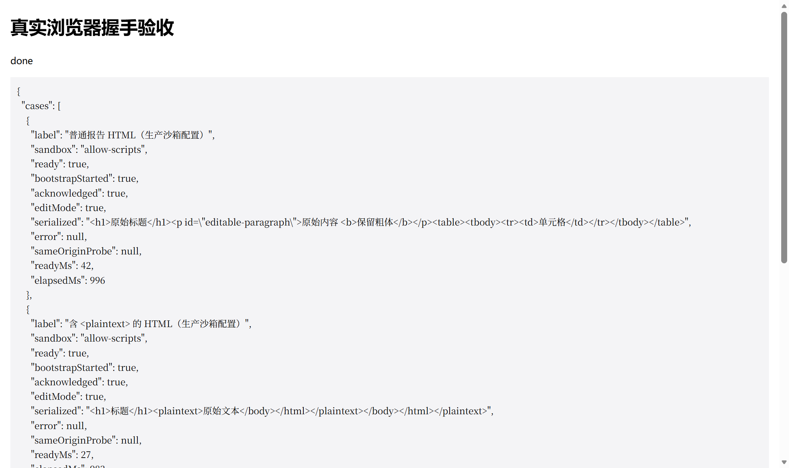

# DSH HTML Visual Editor

Edit a generated HTML file **on the rendered page itself** — no source code view.

English · [中文](#中文说明)

When an agent writes a report to `.html`, DeepSeek Harness shows it as source code.
This plugin adds a file viewer for `dsh-better-sidebar` that renders the document
and lets you edit the text, formatting and layout in place, then writes the result
back to the same file.



## Install

This plugin renders inside the **DSH Better Sidebar**, so install that first:

```sh
dsh plugin --profile web add dsh-better-sidebar
dsh plugin --profile web add github:zimo-2233/dsh-html-visual-editor
```

The install comes straight from this repository; the published bundle
(`lib/client.js`) is committed, so there is no build step and no build-script
approval to grant.

`dsh-better-sidebar` 0.28.0 or newer is required. Without it the plugin stays
inert — it never breaks the app. Nothing else is started: no local server, no
browser extension, no API key, no network call at edit time.

## Use

1. Open a `.html` / `.htm` file in the right sidebar. The document renders as a page.
2. Press **Edit** in the sidebar header. The page becomes directly editable.
3. Select text to apply bold, italic, underline, heading level, font size, text
   colour, highlight, alignment, lists and links. Undo/redo work as usual.
4. Press the **save** button in the header, or `Ctrl/Cmd+S` inside the page.
   This is the only step that writes to the file — there is no autosave.
5. **Preview** shows your unsaved draft again without losing it.

**Rollback:** turn off “HTML 可视化编辑” in the sidebar settings’ viewer list, or
uninstall the plugin. The built-in HTML viewer returns; no other plugin is touched.

## What it saves

For a complete document with an explicit `<body>`, only the body is replaced. The
original doctype, `<head>` (including CSS, links and scripts), the body attributes
and everything after `</body>` are preserved byte for byte. Scripts inside the body
are kept, but they never run in the editor.

## Safety

- The preview runs in an iframe with `sandbox="allow-scripts"` and **without**
  `allow-same-origin`, so the document gets an opaque origin.
- The page’s own scripts, event handlers, forms, frames and outbound connections
  are blocked. Only one nonce-bearing bridge script of this plugin may run.
- The parent window talks to the frame over a single `MessageChannel` port, checked
  against the window source, the opaque origin and a per-load random token.
- Saving goes through the sidebar’s existing authenticated write endpoint, so its
  request fence, file policies, encoding handling and mtime conflict check apply.
  A conflicting change is reported and never overwritten silently.
- Your HTML is not written to `localStorage`, not uploaded, and not sent to any AI
  service. Unsaved drafts live in memory for the current session only (five at most).
- The sidebar service is acquired lazily, so installing this plugin without
  `dsh-better-sidebar` leaves it inert instead of breaking the app.

## Limits

- Built for generated static reports, articles and assignment HTML — not a page
  design tool. There is no drag-and-drop layout, no image replacement, no AI rewrite.
- Pages that build their DOM at runtime (React/Vue apps, chart interactions) cannot
  be edited this way; open the original file in a browser for those.
- The body is re-serialised by the browser, so indentation, quoting style and other
  normalisation details may change. Byte-identical output is not promised for
  arbitrary HTML.
- Documents above 5 MiB are read-only. Without a reliable mtime the document can be
  edited and exported, but not written back.
- Closing a sidebar tab cannot be intercepted reliably; export the draft before you
  close it.

## Development

```sh
npm install
node scripts/build.mjs
npm test
```

The browser acceptance harness lives in `test/browser/`:

```sh
node scripts/build-browser.mjs
node test/browser/server.mjs <workspace-root> 8977
# open http://127.0.0.1:8977/
```

It exercises the real handshake in Chromium: 0.1.1 reaches the ready state in
under 50 ms, while 0.1.0 times out on every case — the regression that 0.1.1 fixes.

## License

MIT — see [LICENSE](LICENSE).

---

# 中文说明

在 DSH 右侧栏里**直接编辑渲染后的 HTML 页面**，而不是切换到源码视图。

当智能体生成一份 `.html` 报告时，DeepSeek Harness 默认按源码显示它。本插件为
`dsh-better-sidebar` 提供一个文件查看器：先把文档渲染成页面，再让你在页面上直接
改文字、改格式，改完写回同一个文件。


## 安装

本插件渲染在 **DSH Better Sidebar** 里，请先安装它：

```sh
dsh plugin --profile web add dsh-better-sidebar
dsh plugin --profile web add github:zimo-2233/dsh-html-visual-editor
```

安装直接来自本仓库；构建产物（`lib/client.js`）已随仓库提交，因此没有构建步骤，
也不需要批准任何安装期脚本。

需要 `dsh-better-sidebar` 0.28.0 或更新版本。若未安装，本插件保持静默，不会影响
宿主运行。除此之外不启动任何服务：没有本地服务器、没有浏览器扩展、不需要 API
Key，编辑过程也不联网。

## 使用

1. 在右侧栏打开 `.html` / `.htm` 文件，文档以页面形式渲染。
2. 点侧栏顶部的**“编辑”**，页面即可直接编辑。
3. 选中文字可加粗、斜体、下划线、改标题级别、字号、文字颜色、背景色、对齐、
   列表与链接，撤销重做照常可用。
4. 点顶部的**保存**图标，或在页面内按 `Ctrl/Cmd+S`。只有这一步会写回文件，
   没有自动保存。
5. **“预览”**会显示当前未保存草稿，不会丢失。

**回退方式：**在侧栏设置的文件查看器列表里关掉“HTML 可视化编辑”，或卸载本插件，
即可回到内置 HTML 查看器，不影响其他插件。

## 保存行为

对带显式 `<body>` 的完整 HTML，只替换 body 内部：原始 doctype、`<head>`
（含 CSS、link、script）、body 属性以及 `</body>` 之后的内容都逐字节保留。body 里的
script 标签会保留，但在编辑器中不执行。

## 安全

- 预览运行在 `sandbox="allow-scripts"` 且**不包含** `allow-same-origin` 的 iframe 中，
  文档因此是不透明来源（opaque origin）。
- 原页面的脚本、事件处理器、表单、内嵌页面与主动连接全部被阻止，只有本插件带
  nonce 的引导脚本可以运行。
- 父子页面通过单条 `MessageChannel` 端口通信，并校验窗口来源、不透明来源与每次
  加载随机生成的 token。
- 保存走侧栏已有的鉴权写接口，继承它的请求防护、文件策略、编码处理与 mtime 冲突
  检查；文件被外部修改时会提示冲突，绝不静默覆盖。
- 你的 HTML 不写入 `localStorage`、不上传、也不发给任何 AI 服务。未保存草稿只存在
  于当前会话内存中（最多五份）。
- 侧栏服务是延迟获取的：没装 `dsh-better-sidebar` 时本插件保持静默，不会弄坏宿主。

## 限制

- 面向生成的静态报告、文章、作业 HTML，不是网页设计器：不提供拖拽布局、替换图片
  与 AI 改写。
- 运行时生成 DOM 的页面（React/Vue 应用、图表交互）无法这样编辑，请用浏览器打开
  原文件。
- body 会经浏览器重新序列化，缩进、引号风格等规范化细节可能变化，不承诺任意
  HTML 字节级无损。
- 超过 5 MiB 的文档只读；没有可靠 mtime 时可编辑、可导出，但不能写盘。
- 宿主无法可靠拦截侧栏标签的关闭动作，关闭前请先导出草稿。

## 开发

```sh
npm install
node scripts/build.mjs
npm test
```

真实浏览器验收在 `test/browser/`：

```sh
node scripts/build-browser.mjs
node test/browser/server.mjs <工作区根目录> 8977
# 打开 http://127.0.0.1:8977/
```

它在真实 Chromium 里跑完整握手：0.1.1 在 50 ms 内进入就绪态，0.1.0 全部用例超时
——这正是 0.1.1 修复的回归。

## 许可

MIT，见 [LICENSE](LICENSE)。
